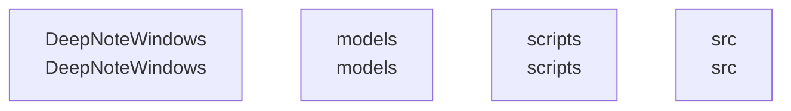

# overall-architecture

[解析トップへ戻る](../README.md)

# classnotex-windows

DeepNote／ClassnoteXのWindowsクライアント。C#のUIと複数のプロジェクト定義を確認。

この図はリポジトリ内の構成です。コードを実行した結果やサービス間の通信保証ではありません。

## 対象と根拠

対象: https://github.com/FORIFOR/classnotex-windows

取得ブランチ: `main`

Git tree SHA: `d0bdb359125e832093ad8b2cce72b83abc5adbc5`

ファイル一覧: 80件。内容確認: 6件。全ファイルの意味解析ではありません。

## 解析の制約

実コードの取得は入口、マニフェスト、直接参照先を中心とする初回解析です。動的ロード、実行時設定、別リポジトリとの接続、ローカル未コミット変更は未確認です。

## 確認が必要な点

構成図の配置関係と、実際の通信・呼び出し関係を区別してください。README上の機能や精度の記述は動作検証済みという意味ではありません。

## 追加解析

未読の中核モジュールから処理順序・データ保存・状態遷移を追加解析する。実行環境で通信先と機能フラグを照合する。

## 補足

2026-10-11の初回解析スナップショットです。現在のコードとの差分や実行環境は追加確認が必要です。

## 要素の説明

### n-deepnotewindows-7ca42d

確認したパス: `DeepNoteWindows`。配下の登録ファイルは33件。

- `DeepNoteWindows/App.xaml`（一覧のみ）
- `DeepNoteWindows/App.xaml.cs`（内容確認済み）
- `DeepNoteWindows/DeepNoteWindows.csproj`（内容確認済み）
- `DeepNoteWindows/Helpers/NavigationHelper.cs`（一覧のみ）
- `DeepNoteWindows/MainWindow.xaml`（一覧のみ）
- `DeepNoteWindows/MainWindow.xaml.cs`（内容確認済み）
- `DeepNoteWindows/Models/AuthModels.cs`（一覧のみ）
- `DeepNoteWindows/Models/FinalizeResponse.cs`（一覧のみ）
- `DeepNoteWindows/Models/JobModels.cs`（一覧のみ）
- `DeepNoteWindows/Models/PagedResponse.cs`（一覧のみ）
- `DeepNoteWindows/Models/Session.cs`（一覧のみ）
- `DeepNoteWindows/Models/TranscriptChunk.cs`（一覧のみ）
- `DeepNoteWindows/Services/ApiService.cs`（一覧のみ）
- `DeepNoteWindows/Services/AudioRecorderService.cs`（一覧のみ）
- `DeepNoteWindows/Services/AuthService.cs`（一覧のみ）
- `DeepNoteWindows/Services/IApiService.cs`（一覧のみ）
- `DeepNoteWindows/Services/IAudioRecorderService.cs`（一覧のみ）
- `DeepNoteWindows/Services/IAuthService.cs`（一覧のみ）
- `DeepNoteWindows/Services/ISherpaOnnxService.cs`（一覧のみ）
- `DeepNoteWindows/Services/SherpaOnnxService.cs`（一覧のみ）
- `DeepNoteWindows/ViewModels/LoginViewModel.cs`（一覧のみ）
- `DeepNoteWindows/ViewModels/RecordingViewModel.cs`（一覧のみ）
- `DeepNoteWindows/ViewModels/SessionListViewModel.cs`（一覧のみ）
- `DeepNoteWindows/ViewModels/TranscriptViewModel.cs`（一覧のみ）
- `DeepNoteWindows/Views/LoginPage.xaml`（一覧のみ）
- `DeepNoteWindows/Views/LoginPage.xaml.cs`（一覧のみ）
- `DeepNoteWindows/Views/RecordingPage.xaml`（一覧のみ）
- `DeepNoteWindows/Views/RecordingPage.xaml.cs`（一覧のみ）
- `DeepNoteWindows/Views/SessionListPage.xaml`（一覧のみ）
- `DeepNoteWindows/Views/SessionListPage.xaml.cs`（一覧のみ）
- `DeepNoteWindows/Views/TranscriptPage.xaml`（一覧のみ）
- `DeepNoteWindows/Views/TranscriptPage.xaml.cs`（一覧のみ）
- `DeepNoteWindows/app.manifest`（一覧のみ）

[詳細な図と説明を見る](n-deepnotewindows-7ca42d/README.md)

### n-models-5ba268

確認したパス: `models`。配下の登録ファイルは1件。

- `models/manifest.json`（一覧のみ）

### n-scripts-16728d

確認したパス: `scripts`。配下の登録ファイルは2件。

- `scripts/ci/windows_prepare_sherpa.ps1`（一覧のみ）
- `scripts/download-model.ps1`（一覧のみ）

### n-src-f27fed

確認したパス: `src`。配下の登録ファイルは39件。

- `src/ClassnoteX.Core/ClassnoteX.Core.csproj`（内容確認済み）
- `src/ClassnoteX.Core/Interfaces/IAudioRecorder.cs`（一覧のみ）
- `src/ClassnoteX.Core/Interfaces/INavigationService.cs`（一覧のみ）
- `src/ClassnoteX.Core/Interfaces/ISessionRepository.cs`（一覧のみ）
- `src/ClassnoteX.Core/Interfaces/ISttService.cs`（一覧のみ）
- `src/ClassnoteX.Core/Interfaces/ISyncService.cs`（一覧のみ）
- `src/ClassnoteX.Core/Models/Session.cs`（一覧のみ）
- `src/ClassnoteX.Core/Models/TranscriptSegment.cs`（一覧のみ）
- `src/ClassnoteX.Infrastructure/ClassnoteX.Infrastructure.csproj`（内容確認済み）
- `src/ClassnoteX.Infrastructure/Entities/SessionEntity.cs`（一覧のみ）
- `src/ClassnoteX.Infrastructure/Repositories/SessionRepository.cs`（一覧のみ）
- `src/ClassnoteX.Infrastructure/Services/AudioRecorderService.cs`（一覧のみ）
- `src/ClassnoteX.Infrastructure/Services/ClassnoteApiClient.cs`（一覧のみ）
- `src/ClassnoteX.Infrastructure/Services/MockSttService.cs`（一覧のみ）
- `src/ClassnoteX.Infrastructure/Services/ModelManagerService.cs`（一覧のみ）
- `src/ClassnoteX.Infrastructure/Services/SherpaSttService.cs`（一覧のみ）
- `src/ClassnoteX.Infrastructure/Services/SyncService.cs`（一覧のみ）
- `src/ClassnoteX.WinUI/App.xaml`（一覧のみ）
- `src/ClassnoteX.WinUI/App.xaml.cs`（一覧のみ）
- `src/ClassnoteX.WinUI/Assets/Logo.png`（一覧のみ）
- `src/ClassnoteX.WinUI/ClassnoteX.WinUI.csproj`（内容確認済み）
- `src/ClassnoteX.WinUI/Converters/BoolNegationConverter.cs`（一覧のみ）
- `src/ClassnoteX.WinUI/MainWindow.xaml`（一覧のみ）
- `src/ClassnoteX.WinUI/MainWindow.xaml.cs`（一覧のみ）
- `src/ClassnoteX.WinUI/Services/NavigationService.cs`（一覧のみ）
- `src/ClassnoteX.WinUI/Services/ServiceLocator.cs`（一覧のみ）
- `src/ClassnoteX.WinUI/ViewModels/DashboardViewModel.cs`（一覧のみ）
- `src/ClassnoteX.WinUI/ViewModels/RecordingViewModel.cs`（一覧のみ）
- `src/ClassnoteX.WinUI/ViewModels/SessionDetailViewModel.cs`（一覧のみ）
- `src/ClassnoteX.WinUI/ViewModels/SessionListViewModel.cs`（一覧のみ）
- `src/ClassnoteX.WinUI/Views/DashboardPage.xaml`（一覧のみ）
- `src/ClassnoteX.WinUI/Views/DashboardPage.xaml.cs`（一覧のみ）
- `src/ClassnoteX.WinUI/Views/RecordingPage.xaml`（一覧のみ）
- `src/ClassnoteX.WinUI/Views/RecordingPage.xaml.cs`（一覧のみ）
- `src/ClassnoteX.WinUI/Views/SessionDetailPage.xaml`（一覧のみ）

[詳細な図と説明を見る](n-src-f27fed/README.md)

