# overall-architecture/n-deepnotewindows-7ca42d

[解析トップへ戻る](../../README.md)

確認したパス: `DeepNoteWindows`。配下の登録ファイルは33件。

- `DeepNoteWindows/App.xaml`（一覧のみ）
- `DeepNoteWindows/App.xaml.cs`（内容確認済み）
- `DeepNoteWindows/DeepNoteWindows.csproj`（内容確認済み）
- `DeepNoteWindows/Helpers/NavigationHelper.cs`（一覧のみ）
- `DeepNoteWindows/MainWindow.xaml`（一覧のみ）
- `DeepNoteWindows/MainWindow.xaml.cs`（内容確認済み）
- `DeepNoteWindows/Models/AuthModels.cs`（一覧のみ）
- `DeepNoteWindows/Models/FinalizeResponse.cs`（一覧のみ）
- `DeepNoteWindows/Models/JobModels.cs`（一覧のみ）
- `DeepNoteWindows/Models/PagedResponse.cs`（一覧のみ）
- `DeepNoteWindows/Models/Session.cs`（一覧のみ）
- `DeepNoteWindows/Models/TranscriptChunk.cs`（一覧のみ）
- `DeepNoteWindows/Services/ApiService.cs`（一覧のみ）
- `DeepNoteWindows/Services/AudioRecorderService.cs`（一覧のみ）
- `DeepNoteWindows/Services/AuthService.cs`（一覧のみ）
- `DeepNoteWindows/Services/IApiService.cs`（一覧のみ）
- `DeepNoteWindows/Services/IAudioRecorderService.cs`（一覧のみ）
- `DeepNoteWindows/Services/IAuthService.cs`（一覧のみ）
- `DeepNoteWindows/Services/ISherpaOnnxService.cs`（一覧のみ）
- `DeepNoteWindows/Services/SherpaOnnxService.cs`（一覧のみ）
- `DeepNoteWindows/ViewModels/LoginViewModel.cs`（一覧のみ）
- `DeepNoteWindows/ViewModels/RecordingViewModel.cs`（一覧のみ）
- `DeepNoteWindows/ViewModels/SessionListViewModel.cs`（一覧のみ）
- `DeepNoteWindows/ViewModels/TranscriptViewModel.cs`（一覧のみ）
- `DeepNoteWindows/Views/LoginPage.xaml`（一覧のみ）
- `DeepNoteWindows/Views/LoginPage.xaml.cs`（一覧のみ）
- `DeepNoteWindows/Views/RecordingPage.xaml`（一覧のみ）
- `DeepNoteWindows/Views/RecordingPage.xaml.cs`（一覧のみ）
- `DeepNoteWindows/Views/SessionListPage.xaml`（一覧のみ）
- `DeepNoteWindows/Views/SessionListPage.xaml.cs`（一覧のみ）
- `DeepNoteWindows/Views/TranscriptPage.xaml`（一覧のみ）
- `DeepNoteWindows/Views/TranscriptPage.xaml.cs`（一覧のみ）
- `DeepNoteWindows/app.manifest`（一覧のみ）

```mermaid
graph TD
    n-deepnotewindows-helpers-929362["Helpers\nDeepNoteWindows/Helpers"]
    n-deepnotewindows-models-14178f["Models\nDeepNoteWindows/Models"]
    n-deepnotewindows-services-f60d8c["Services\nDeepNoteWindows/Services"]
    n-deepnotewindows-viewmodels-9182c1["ViewModels\nDeepNoteWindows/ViewModels"]
    n-deepnotewindows-views-e88851["Views\nDeepNoteWindows/Views"]
    n-deepnotewindows-app-xaml-cs-0de226["App.xaml.cs\nDeepNoteWindows/App.xaml.cs"]
    n-deepnotewindows-mainwindow-xaml-cs-4cbe92["MainWindow.xaml.cs\nDeepNoteWindows/MainWindow.xaml.cs"]
```

## 要素の説明

### n-deepnotewindows-app-xaml-cs-0de226

実在パス: `DeepNoteWindows/App.xaml.cs`。1ファイル。

- `DeepNoteWindows/App.xaml.cs`

### n-deepnotewindows-helpers-929362

実在パス: `DeepNoteWindows/Helpers`。1ファイル。

- `DeepNoteWindows/Helpers/NavigationHelper.cs`

### n-deepnotewindows-mainwindow-xaml-cs-4cbe92

実在パス: `DeepNoteWindows/MainWindow.xaml.cs`。1ファイル。

- `DeepNoteWindows/MainWindow.xaml.cs`

### n-deepnotewindows-models-14178f

実在パス: `DeepNoteWindows/Models`。6ファイル。

- `DeepNoteWindows/Models/AuthModels.cs`
- `DeepNoteWindows/Models/FinalizeResponse.cs`
- `DeepNoteWindows/Models/JobModels.cs`
- `DeepNoteWindows/Models/PagedResponse.cs`
- `DeepNoteWindows/Models/Session.cs`
- `DeepNoteWindows/Models/TranscriptChunk.cs`

### n-deepnotewindows-services-f60d8c

実在パス: `DeepNoteWindows/Services`。8ファイル。

- `DeepNoteWindows/Services/ApiService.cs`
- `DeepNoteWindows/Services/AudioRecorderService.cs`
- `DeepNoteWindows/Services/AuthService.cs`
- `DeepNoteWindows/Services/IApiService.cs`
- `DeepNoteWindows/Services/IAudioRecorderService.cs`
- `DeepNoteWindows/Services/IAuthService.cs`
- `DeepNoteWindows/Services/ISherpaOnnxService.cs`
- `DeepNoteWindows/Services/SherpaOnnxService.cs`

### n-deepnotewindows-viewmodels-9182c1

実在パス: `DeepNoteWindows/ViewModels`。4ファイル。

- `DeepNoteWindows/ViewModels/LoginViewModel.cs`
- `DeepNoteWindows/ViewModels/RecordingViewModel.cs`
- `DeepNoteWindows/ViewModels/SessionListViewModel.cs`
- `DeepNoteWindows/ViewModels/TranscriptViewModel.cs`

### n-deepnotewindows-views-e88851

実在パス: `DeepNoteWindows/Views`。8ファイル。

- `DeepNoteWindows/Views/LoginPage.xaml`
- `DeepNoteWindows/Views/LoginPage.xaml.cs`
- `DeepNoteWindows/Views/RecordingPage.xaml`
- `DeepNoteWindows/Views/RecordingPage.xaml.cs`
- `DeepNoteWindows/Views/SessionListPage.xaml`
- `DeepNoteWindows/Views/SessionListPage.xaml.cs`
- `DeepNoteWindows/Views/TranscriptPage.xaml`
- `DeepNoteWindows/Views/TranscriptPage.xaml.cs`

