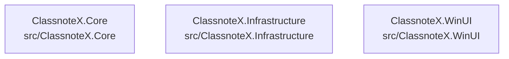

# overall-architecture/n-src-f27fed

[解析トップへ戻る](../../README.md)

確認したパス: `src`。配下の登録ファイルは39件。

- `src/ClassnoteX.Core/ClassnoteX.Core.csproj`（内容確認済み）
- `src/ClassnoteX.Core/Interfaces/IAudioRecorder.cs`（一覧のみ）
- `src/ClassnoteX.Core/Interfaces/INavigationService.cs`（一覧のみ）
- `src/ClassnoteX.Core/Interfaces/ISessionRepository.cs`（一覧のみ）
- `src/ClassnoteX.Core/Interfaces/ISttService.cs`（一覧のみ）
- `src/ClassnoteX.Core/Interfaces/ISyncService.cs`（一覧のみ）
- `src/ClassnoteX.Core/Models/Session.cs`（一覧のみ）
- `src/ClassnoteX.Core/Models/TranscriptSegment.cs`（一覧のみ）
- `src/ClassnoteX.Infrastructure/ClassnoteX.Infrastructure.csproj`（内容確認済み）
- `src/ClassnoteX.Infrastructure/Entities/SessionEntity.cs`（一覧のみ）
- `src/ClassnoteX.Infrastructure/Repositories/SessionRepository.cs`（一覧のみ）
- `src/ClassnoteX.Infrastructure/Services/AudioRecorderService.cs`（一覧のみ）
- `src/ClassnoteX.Infrastructure/Services/ClassnoteApiClient.cs`（一覧のみ）
- `src/ClassnoteX.Infrastructure/Services/MockSttService.cs`（一覧のみ）
- `src/ClassnoteX.Infrastructure/Services/ModelManagerService.cs`（一覧のみ）
- `src/ClassnoteX.Infrastructure/Services/SherpaSttService.cs`（一覧のみ）
- `src/ClassnoteX.Infrastructure/Services/SyncService.cs`（一覧のみ）
- `src/ClassnoteX.WinUI/App.xaml`（一覧のみ）
- `src/ClassnoteX.WinUI/App.xaml.cs`（一覧のみ）
- `src/ClassnoteX.WinUI/Assets/Logo.png`（一覧のみ）
- `src/ClassnoteX.WinUI/ClassnoteX.WinUI.csproj`（内容確認済み）
- `src/ClassnoteX.WinUI/Converters/BoolNegationConverter.cs`（一覧のみ）
- `src/ClassnoteX.WinUI/MainWindow.xaml`（一覧のみ）
- `src/ClassnoteX.WinUI/MainWindow.xaml.cs`（一覧のみ）
- `src/ClassnoteX.WinUI/Services/NavigationService.cs`（一覧のみ）
- `src/ClassnoteX.WinUI/Services/ServiceLocator.cs`（一覧のみ）
- `src/ClassnoteX.WinUI/ViewModels/DashboardViewModel.cs`（一覧のみ）
- `src/ClassnoteX.WinUI/ViewModels/RecordingViewModel.cs`（一覧のみ）
- `src/ClassnoteX.WinUI/ViewModels/SessionDetailViewModel.cs`（一覧のみ）
- `src/ClassnoteX.WinUI/ViewModels/SessionListViewModel.cs`（一覧のみ）
- `src/ClassnoteX.WinUI/Views/DashboardPage.xaml`（一覧のみ）
- `src/ClassnoteX.WinUI/Views/DashboardPage.xaml.cs`（一覧のみ）
- `src/ClassnoteX.WinUI/Views/RecordingPage.xaml`（一覧のみ）
- `src/ClassnoteX.WinUI/Views/RecordingPage.xaml.cs`（一覧のみ）
- `src/ClassnoteX.WinUI/Views/SessionDetailPage.xaml`（一覧のみ）

## 要素の説明

### n-src-classnotex-core-c07b30

実在パス: `src/ClassnoteX.Core`。8ファイル。

- `src/ClassnoteX.Core/ClassnoteX.Core.csproj`
- `src/ClassnoteX.Core/Interfaces/IAudioRecorder.cs`
- `src/ClassnoteX.Core/Interfaces/INavigationService.cs`
- `src/ClassnoteX.Core/Interfaces/ISessionRepository.cs`
- `src/ClassnoteX.Core/Interfaces/ISttService.cs`
- `src/ClassnoteX.Core/Interfaces/ISyncService.cs`
- `src/ClassnoteX.Core/Models/Session.cs`
- `src/ClassnoteX.Core/Models/TranscriptSegment.cs`

### n-src-classnotex-infrastructure-ec185b

実在パス: `src/ClassnoteX.Infrastructure`。9ファイル。

- `src/ClassnoteX.Infrastructure/ClassnoteX.Infrastructure.csproj`
- `src/ClassnoteX.Infrastructure/Entities/SessionEntity.cs`
- `src/ClassnoteX.Infrastructure/Repositories/SessionRepository.cs`
- `src/ClassnoteX.Infrastructure/Services/AudioRecorderService.cs`
- `src/ClassnoteX.Infrastructure/Services/ClassnoteApiClient.cs`
- `src/ClassnoteX.Infrastructure/Services/MockSttService.cs`
- `src/ClassnoteX.Infrastructure/Services/ModelManagerService.cs`
- `src/ClassnoteX.Infrastructure/Services/SherpaSttService.cs`
- `src/ClassnoteX.Infrastructure/Services/SyncService.cs`

### n-src-classnotex-winui-6d495b

実在パス: `src/ClassnoteX.WinUI`。22ファイル。

- `src/ClassnoteX.WinUI/App.xaml`
- `src/ClassnoteX.WinUI/App.xaml.cs`
- `src/ClassnoteX.WinUI/Assets/Logo.png`
- `src/ClassnoteX.WinUI/ClassnoteX.WinUI.csproj`
- `src/ClassnoteX.WinUI/Converters/BoolNegationConverter.cs`
- `src/ClassnoteX.WinUI/MainWindow.xaml`
- `src/ClassnoteX.WinUI/MainWindow.xaml.cs`
- `src/ClassnoteX.WinUI/Services/NavigationService.cs`
- `src/ClassnoteX.WinUI/Services/ServiceLocator.cs`
- `src/ClassnoteX.WinUI/ViewModels/DashboardViewModel.cs`
- `src/ClassnoteX.WinUI/ViewModels/RecordingViewModel.cs`
- `src/ClassnoteX.WinUI/ViewModels/SessionDetailViewModel.cs`
- `src/ClassnoteX.WinUI/ViewModels/SessionListViewModel.cs`
- `src/ClassnoteX.WinUI/Views/DashboardPage.xaml`
- `src/ClassnoteX.WinUI/Views/DashboardPage.xaml.cs`
- `src/ClassnoteX.WinUI/Views/RecordingPage.xaml`
- `src/ClassnoteX.WinUI/Views/RecordingPage.xaml.cs`
- `src/ClassnoteX.WinUI/Views/SessionDetailPage.xaml`
- `src/ClassnoteX.WinUI/Views/SessionDetailPage.xaml.cs`
- `src/ClassnoteX.WinUI/Views/SessionListPage.xaml`
- `src/ClassnoteX.WinUI/Views/SessionListPage.xaml.cs`
- `src/ClassnoteX.WinUI/app.manifest`

